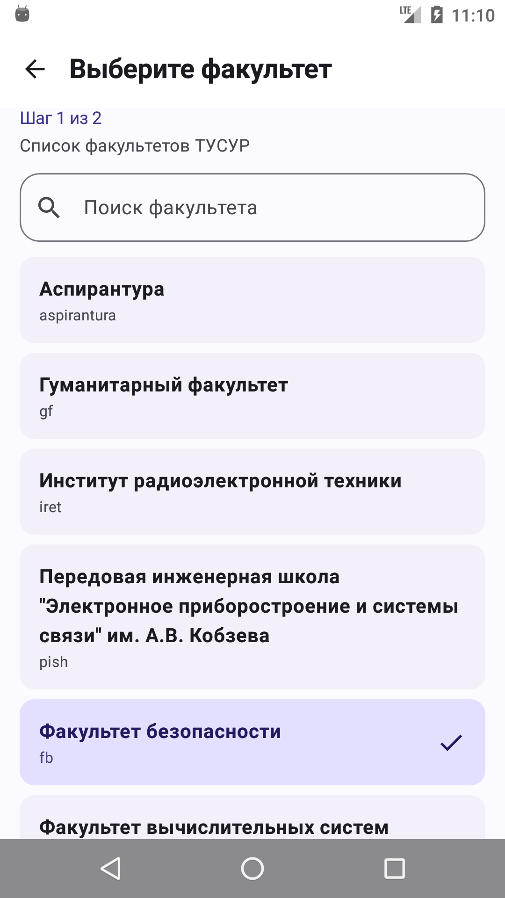
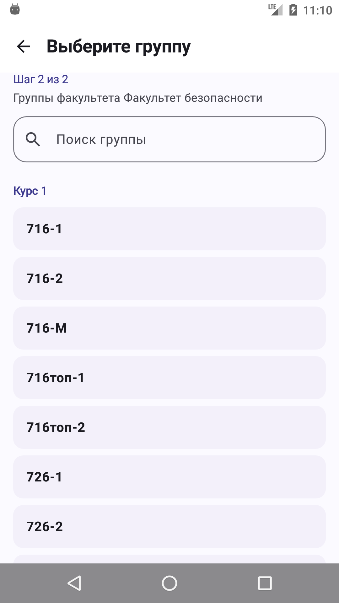
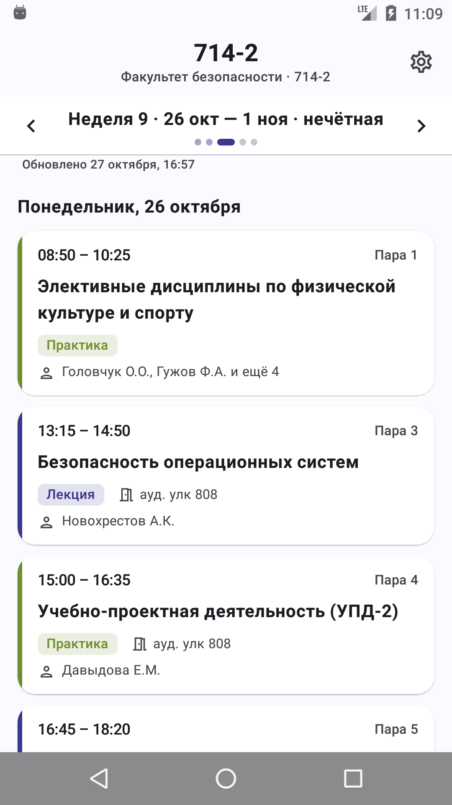
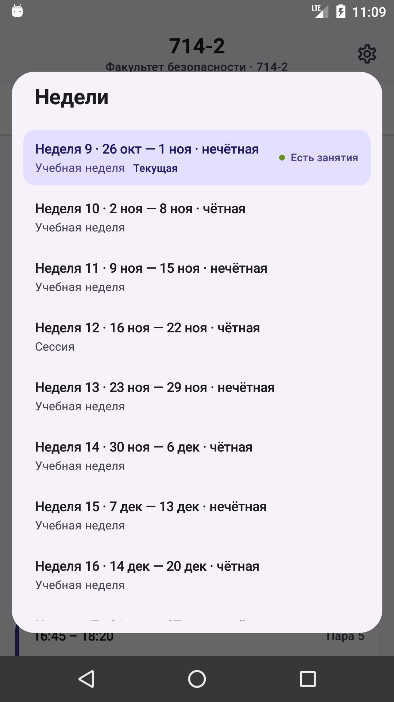
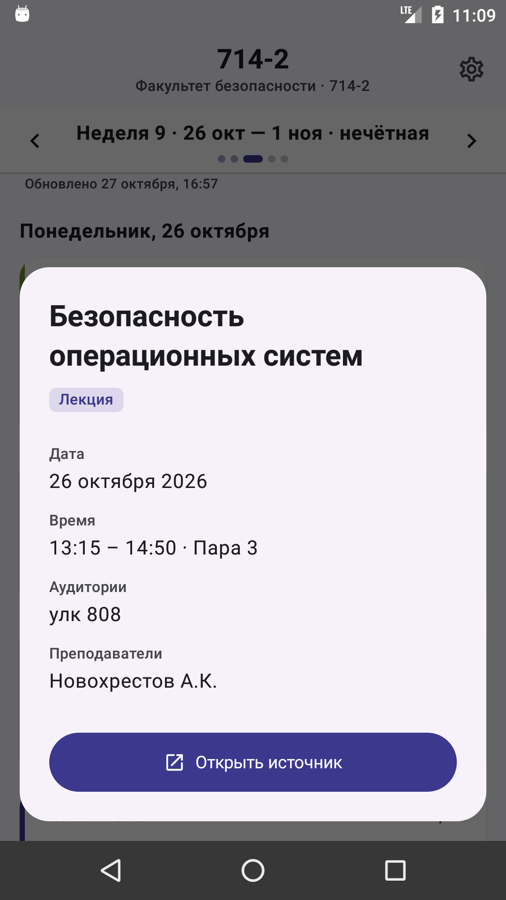
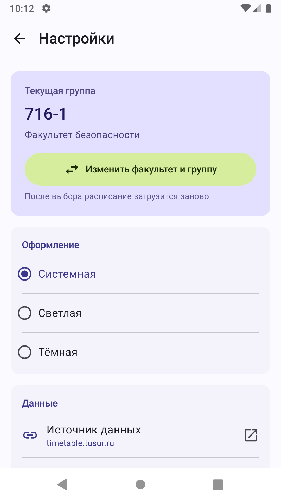
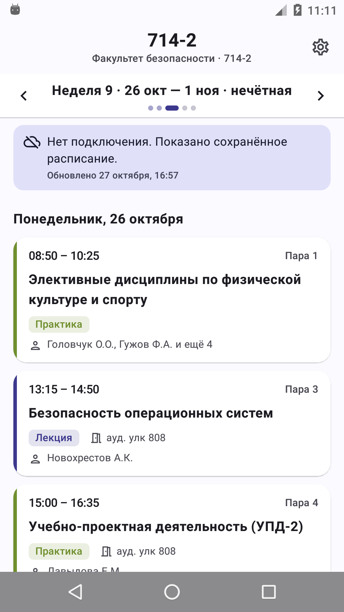
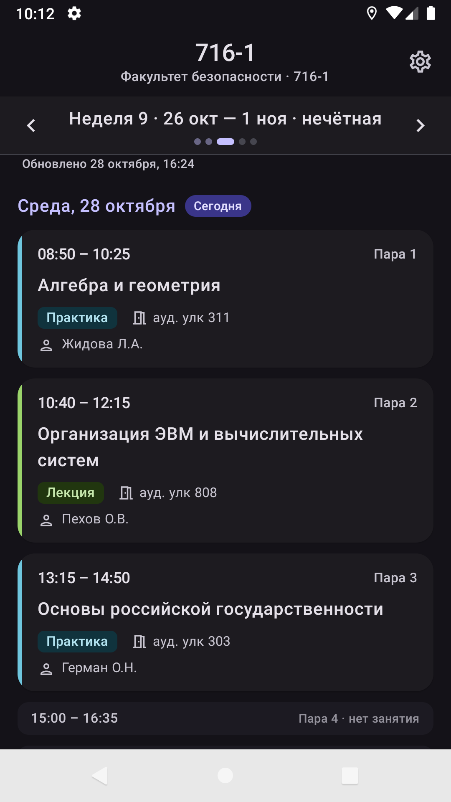
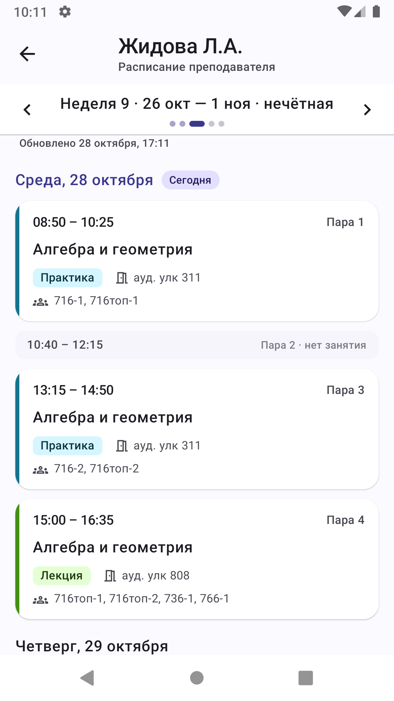

# Расписание ТУСУР

[](https://github.com/Keisha2112/tusur-timetable/releases/latest)

Неофициальное Android-приложение для просмотра расписания занятий групп и преподавателей
ТУСУР. Показывает расписание на текущую неделю, свободные пары, позволяет листать недели
свайпом, открывать детали занятия, переходить к расписанию преподавателя и работать
без интернета за счёт локального кэша.

**Приложение не связано с ТУСУР.** Данные берутся с открытого сайта
[timetable.tusur.ru](https://timetable.tusur.ru).

## Скачать

Готовый APK лежит в разделе [Releases](https://github.com/Keisha2112/tusur-timetable/releases/latest).
Прямая ссылка на файл:
[`tusur-timetable-1.1.2.apk`](https://github.com/Keisha2112/tusur-timetable/releases/latest/download/tusur-timetable-1.1.2.apk).

## Возможности

- выбор факультета и группы при первом запуске, с поиском и разбивкой по курсам;
- автоматическое открытие расписания выбранной группы при следующих запусках;
- расписание на текущую неделю, переход по неделям кнопками, свайпом или выбором из списка;
- будущие опубликованные недели подгружаются автоматически, даже если их ещё нет в ICS;
- плавная анимация перелистывания недель: следующая въезжает справа, предыдущая — слева;
- текущая неделя открывается сразу на сегодняшнем дне, остальные — с понедельника;
- свободные пары («окна») видны в тот же день, что и занятия;
- карточки занятий с временем, номером пары, типом, аудиторией и преподавателями;
- цвета типов занятий повторяют палитру сайта;
- детали занятия в отдельном окне и ссылка на источник;
- расписание преподавателя открывается нажатием на его имя в деталях занятия;
- на экране преподавателя показывается полное ФИО;
- смена факультета и группы в настройках;
- выбор оформления: системная, светлая или тёмная тема;
- кэширование каталога, расписания групп и преподавателей, работа без интернета;
- ручное обновление подтягивает все опубликованные недели, включая ещё не загруженные в кэш.

## Скриншоты

| Выбор факультета | Группы | Расписание |
| --- | --- | --- |
|  |  |  |

| Выбор недели | Детали занятия | Настройки |
| --- | --- | --- |
|  |  |  |

| Без интернета | Тёмная тема | Расписание преподавателя |
| --- | --- | --- |
|  |  |  |

## Требования

- Android 6.0 (API 23) и новее;
- интернет для первой загрузки и обновлений.

## Установка

1. Скачайте APK со страницы [Releases](https://github.com/Keisha2112/tusur-timetable/releases/latest).
2. Android 6–7: «Настройки → Безопасность → Неизвестные источники» → разрешить для
   файлового менеджера или браузера.
3. Android 8+: «Установка неизвестных приложений» → разрешить для приложения,
   из которого открываете APK.
4. Откройте APK и подтвердите установку. Если Play Protect предупреждает,
   выберите «Установить всё равно».
5. Запустите приложение, выберите факультет и группу.

Обновление выполняется установкой нового APK поверх старого: package name и ключ
подписи те же, настройки и кэш сохраняются.

## SHA-256

Файл `tusur-timetable-1.1.2.apk` из раздела Releases:

```text
EC70CA11ACC76B55FC3FE9900F6BA00C5119E4B50DDCABCDAF6716E9CB6F57FB
```

Для сборки из исходников APK лежит в `app/build/outputs/apk/release/app-release.apk`.

## Ограничения

- отдельного каталога преподавателей нет: их расписание открывается из деталей занятия;
- нет уведомлений, виджета и синхронизации с календарём;
- примечания и отмены из HTML-таблицы сайта не разбираются;
- расписание публикуется на сайте не на весь семестр: пустые недели — нормальное состояние;
- при удалении приложения сохранённые настройки и кэш теряются.

## Сборка из исходников

Требуется JDK 17+ и Android SDK с платформой 36.

```bash
# debug
./gradlew assembleDebug

# release (нужен keystore.properties в корне проекта)
./gradlew assembleRelease

# unit-тесты
./gradlew testDebugUnitTest
```

`keystore.properties` и файл ключа не входят в репозиторий. Без них release-сборка
получится неподписанной.

Иконки генерируются из `docs/icon-source.png` скриптом `scripts/make_icons.py`
(нужен Pillow): он собирает адаптивную иконку, монохромный слой и растровые PNG
для Android 6–7.

### Если путь к проекту содержит кириллицу

Gradle на Windows пишет аргументы тестовой JVM в argfile в системной кодировке и
не находит классы по таким путям: сборка APK проходит, а unit-тесты падают с
`ClassNotFoundException`. Обход — запускать тесты через junction с ASCII-путём:

```powershell
.\scripts\gradle.ps1 testDebugUnitTest
```

Скрипт создаёт `C:\tusur-work` → папку проекта и запускает там указанную задачу.
В `gradle.properties` отключена инкрементальная компиляция Kotlin: при сборке через
junction она периодически «теряет» символы соседних файлов модуля.

## Технологии

Kotlin, Jetpack Compose, Material 3, Navigation Compose, Room, DataStore,
OkHttp, Jsoup, biweekly, kotlinx.serialization, coroutines. minSdk 23,
compileSdk/targetSdk 36, core library desugaring.

Отдельно стоит отметить TLS. Сайт отдаёт сертификат `*.tusur.ru` от GlobalSign
GCC R46 AlphaSSL CA 2025, а корень R46 есть в системном хранилище только с Android 14.
На Android 8–13 цепочка не проверяется, поэтому приложение добавляет корень R46
и промежуточный сертификат как дополнительные якоря на всех версиях Android
(системная проверка не отключается и выполняется первой).

## Структура

```text
app/src/main/java/com/keisha/tusur/timetable/
  data/network      клиент сайта, адреса, TLS для Android 6
  data/parser       парсеры каталога, недель, преподавателей и .ics
  data/local        Room и DataStore
  data/repository   репозитории с кэшем и ETag
  domain/model      модели
  domain/time       часовой пояс, пары, форматирование
  ui                Compose-экраны, компоненты, тема
```

## Тесты

- unit-тесты (100): парсеры на реальных HTML/ICS-снимках сайта, клиент на MockWebServer,
  кэш и ETag в репозиториях групп и преподавателей, окна и прокрутка списка,
  форматирование дат и пар;
- UI-тесты Compose для карточки занятия и панели недели (`app/src/androidTest`).

Проверено вручную на эмуляторах Android 6.0 (API 23), Android 9 (API 28) и
Android 16 (API 36): онбординг, расписание, свайпы недель, свободные пары,
детали занятия, переход к преподавателю, настройки, все три темы, офлайн-кэш.

## Источник данных и правовой статус

Сайт: <https://timetable.tusur.ru>. Приложение использует только общедоступные
страницы и экспорт iCal. Логотип и фирменный стиль ТУСУР не используются,
приложение не выдаётся за официальное.

## Лицензия

Личный проект для себя и друзей. Код можно использовать как основу
для собственных некоммерческих задач.
